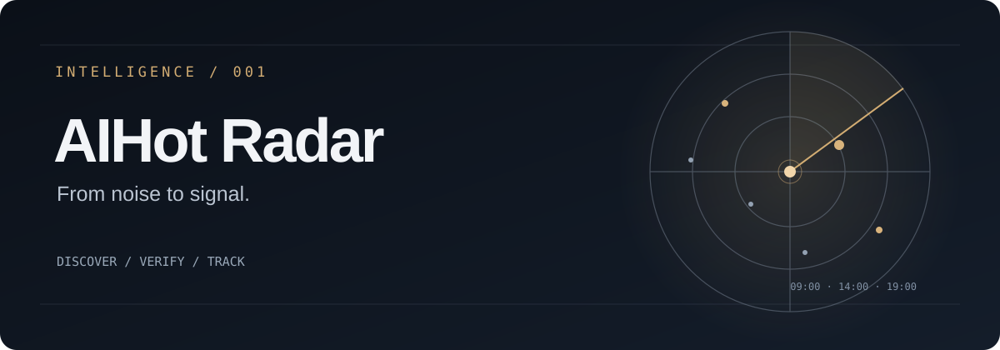

<div align="center">



**每天三次扫描 AI 热点，留下值得追踪的真实信号。**

[查看最新日报](reports/2026/10/10.md) · [历史报告](reports/) · [报告规范](REPORT_SPEC.md)

</div>

## 为什么做

热点每天都在刷新，但真正值得关注的变化不多。

AIHot Radar 从 [AIHot](https://aihot.news/) 发现线索，追溯论文、官方公告、代码仓库等原始来源，结合 **7 天演变和约 30 天历史**判断趋势，整理成可核验、可持续更新的研究报告。

关注 AI 模型、Agent / Harness、评测、开发者工具、开源生态，以及产品、商业化与增长机会。低热度但有潜力的新项目，同样值得记录。

## 阅读报告

**[2026-10-10 · AIHot 强信号雷达 →](reports/2026/10/10.md)**

每份报告重点回答：

- **发生了什么**：新增事实、原始出处和关键证据。
- **趋势如何变化**：过去 7 天的演变、约 30 天的持续性，以及反证。
- **为什么值得关注**：技术机制、产品机会、成本和现实限制。
- **哪些值得分享**：附证据链接的 X 推文候选与待验证点。

仅保留有价值的信号；证据不足就标明不确定性，不为凑数量而收录。

## 工作方式

```text
AIHot 发现线索
    ↓
去重与溯源 ── 论文 / 官方公告 / GitHub / 一手数据
    ↓
证据分级与交叉核验
    ↓
7 天演变 + 30 天趋势判断
    ↓
日报 / 推文候选 / 后续观察
```

每天 **09:00、14:00、19:00（北京时间）** 运行：

| 时间 | 关注重点 |
| --- | --- |
| 09:00 | 建立当天基线，识别高价值信号 |
| 14:00 | 追踪新增证据、反证与判断变化 |
| 19:00 | 汇总最终判断、分享候选和次日观察 |

同一天的三次结果更新至同一个文件：`reports/YYYY/MM/DD.md`。仅在有实质变化时更新判断，避免重复报道。报告由自动化任务直接写入 `main`，不自动发布推文。

## 研究原则

**Signal Value > Heat Score**

- 聚合热度只用于发现线索；关键结论尽量追到一手证据。
- 区分已验证事实、作者主张、社区证据与推断。
- 保留相反证据，明确不确定性；热度上涨不等于趋势成立。
- 优先记录可操作的技术进展、产品机会和长期变化。

具体的接口选择、证据标签、去重、增量更新与验收规则见 [REPORT_SPEC.md](REPORT_SPEC.md)。

---

**相关项目**：[HNews Radar](https://github.com/geekjourneyx/hnews-radar) 聚焦 Hacker News 社区和项目讨论，与 AIHot Radar 的 AI 行业信号视角互补。

**数据源**：[AIHot](https://aihot.news/) · [Agent API](https://aihot.news/api/v1/agent)
